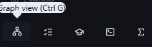
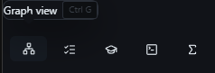
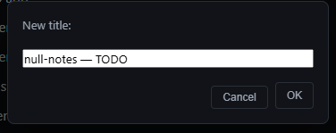
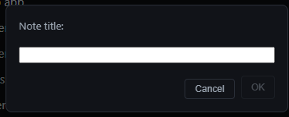

# null-notes — TODO

## TODO's

- [ ] Better printing — Export to PDF and Print are now separate File menu items, each a small dialog ending in a silent WebView2 call (`PrintToPdf`/`Print`, never `ShowPrintUI`). One checkbox ("Include page numbers, date, and title") controls WebView2's all-or-nothing header/footer bundle. Fixed two real pagination gaps (`h4`-`h6` and block-math/diagrams could split across a page). **Design:** `docs/specs/better-printing-design.md`. **Plan:** `docs/plans/better-printing.md`.   preview and export only show data when a checkmark has been set the data in the export is completely malformed it is mostly clipped dom.js:727 Uncaught TypeError: Cannot read properties of null (reading 'nextSibling')
- [ ] Use the built git feature to sync workspaces to other machines
- [ ] Mobile app (need to think how we get syncing working)
- [ ] Web app (no local md files fully git)
- [ ] add a open in null notes in my ide
- [ ] fix top toolbar
- [ ] editing larger notes is extremely laggy
- [ ] when we select what do we want to copy? (currently its the markdown this is a design question)
- [ ] pasting markdown gets code block with language set to markdown (pasting is entirely broken)
- [ ] renaming doesnt stick title is still old
- [ ] markdown render arrows (-&gt; / &lt;-&gt; / &lt;-) (renders in source but not in preview)
- [ ] Search needs major improvements
- [ ] Console warning: "flushSync was called from inside a lifecycle method" — comes from `@tiptap/react`'s `ReactRenderer` (node_modules/@tiptap/react/src/ReactRenderer.tsx:193), which flushSyncs on first render of a `ReactNodeViewRenderer` node view (wiki-links/hover-previews) to keep cursor position stable. Fires when that node view mounts during another component's React commit phase. Cosmetic/upstream so far — no reproduced functional break; find which call site creates the node view mid-lifecycle if it needs fixing.
- [ ] settings tab needs a redesign pass
- [ ] Runaway backslash duplication corrupted a task-item line in TODO.md (grew to 65MB/65M backslashes locally; git history already has a 16.8MB `TODO.md` committed at HEAD `c9b1529` from the same bug, doubling roughly each save: 108KB → 124KB → 141KB → 2.2MB → 16.8MB). Ruled out: the shared `prosemirror-markdown`/`tiptap-markdown` parse↔serialize round trip (`esc()` backslash-escaping) — reproduced it directly with `coreExtensions` across repeated open/save cycles, stable, no growth. Still unexplained: what actually duplicates content on save. Candidates to check live (needs the real running app, not vitest): a paste handler or math/`SmartSymbols` input rule misfiring on `\`, or something in the autosave/reindex path re-appending old content instead of replacing it. Needs `main`'s HEAD `TODO.md` history cleaned up too (still 16.8MB there even though the working copy is fixed).
- [ ] better loading screen
- [ ] store scroll position
- [ ] better cram mode design with better completion of category /
- [ ] show how many cards are left in current category (cram mode)
- [ ] this cram mode data doesnt get commited (

  <!-- sr due=2026-09-13 ease=2.65 interval=8 reps=2 grade=easy streak=2 -->

  )
- [ ] Shell extension open in null notes (both for folder (workspace) and single files that get copied into a temp workspace)
- [x] Left sidebar needs a design update (especially files and folders)
- [x] Close Workspace
- [x] Recent workspaces
- [x] Recent workspaces in right click menu
- [x] add images to flashcards (also reveal backside image as answer)
- [x] Dragging a note or folder onto a destination that already had a same-named note/folder silently overwrote it — `move_note_at`/`rename_folder_at` called `fs::rename` straight to the destination, which replaces an existing file on Windows with no warning. Surfaced as a React "duplicate key" console error (two open tabs left pointing at the one surviving path) rather than as the actual data loss. Both now check the destination first and reject the move with an error instead of touching anything.
- [x] reorder open tabs
- [x] search doesnt jump
- [x] all . folders aren't auto committed deleted and renamed files are also an issue
- [x] fix db flakiness
- [x] fix and improve these tooltips designs
- [x] These info's position needs to be better — save/git status chips lived in the same scrollable flex row as the tabs (`margin-left: auto` inside `.tab-bar`'s own `overflow-x: auto`), so with enough open tabs they scrolled out of view. Split into `.tab-bar-tabs` (scrolls) and `.tab-bar-status` (pinned, always visible).
- [x] Recent searches only works current session — was already fixed by P6-5; failure was a stale Tauri binary (Vite HMR served the new frontend against an old, unrebuilt Rust process)
- [x] Custom Titlebar (no windows default)
- [x] Better window title with what workspace / file is open
- [x] This modal needs to be fixed
- [x] Reorder task function invoked manually (apple notes has it by default but im not sure if i like it automatically) but the point is to reorder marked tasks to the bottom which would focus the next tasks at the top
- [x] Home Button — clickable Home entry in the sidebar nav group, next to Search/Settings
- [x] Outline in better place — now a persistent right-side rail beside the note, not stacked below its content
- [x] Custom Modals for new for example — `PromptDialog` (in-app) replaces `window.prompt`; `window.confirm`/`alert` replaced with the native Tauri dialog already used in Settings
- [x] Shift + ? opens shortcuts which shouldnt happen as thats the way i write '?' — the `?` listener now ignores editable targets
- [x] != should convert to the unequal icon, &lt;= &gt;= too — `SmartSymbols` input rule (`≠`/`≤`/`≥`), skipped inside code
- [x] Dragging doesnt work — Tauri's `dragDropEnabled` (on by default) was swallowing HTML5 drag events on Windows; now off
- [x] Add $ $ Inline math as slash command — already existed as "Inline Equation"; renamed to "Inline Math" so `/math` finds it
- [x] The auto git doesnt handle its own .gitignore — `checked_init_notes_repo` now commits the `.gitignore` it writes; auto-commit also merges the required lines into a pre-existing repo's `.gitignore` (Notes-only/Notes-monorepo only)
- [x] Git actions constantly open terminals in the built app — every `git`/`gh` spawn now sets `CREATE_NO_WINDOW` on Windows
- [x] Better custom modals design — the shared dialog chrome (`.settings-panel`, `.search-modal`, `.import-mode-dialog`, `.search-overlay`) had every button reading the same flat bordered-ghost weight regardless of importance, and a flat backdrop with no depth. Added `.dialog-action-primary` (filled accent, reuses `.workspace-picker-browse`'s hover-lift/glow language) for the one affirmative action per dialog — `PromptDialog`'s OK, `TemplateDialog`'s Create, `FormulaSheetPrompt`'s Generate — while Cancel/Back stay ghost. `.search-overlay` gained a `backdrop-filter: blur(3px)` for real separation from the app behind it, and the panel corner radius went 8px → 10px to match.
- [x] Folders arent working properly — renaming/deleting a folder left `selectedFolder`/`expandedFolders` pointing at the stale path (the very next "New Note"/"New Folder" then wrote to a directory that no longer existed, and the row silently lost its expand/select state); `replaceOpenPath` now propagates a path change to those too, not just open tabs. Also: folders can now be dragged onto another folder to nest them (`renameFolder` already supported cross-directory moves, just wasn't exposed). **Second pass, found by an e2e repro of "can't see notes inside folders":** a folder always renders collapsed on creation, and a note lands in `selectedFolder ?? workspacePath` — so a freshly created folder's first note was invisible with no visual cue anything had happened. New `expandFolder` store action (add-only, unlike `toggleFolder`) is now called after creating a folder, after creating a note/canvas-note/PDF import in one, and after a drag-drop lands something in one. **Third pass:** the first root-drop target (the tiny workspace-name label) was real but impractical to hit with a real mouse — moved onto the root-level folder-tree list itself, which is only ever rendered once (nested folders render their own `<ul>` inline) and already fills the sidebar's whole remaining height, so dropping anywhere in its background or on a root-level note now moves the item to root. **Fourth pass — root cause of the missing-note report:** a real user has the same folder open as two separate workspaces (a subfolder standalone, and again as part of its parent). `db::notes::index_note`'s `ON CONFLICT(path) DO UPDATE` never updated the `workspace` column, only `title`/`updated_at` — so once a note's path was indexed under one workspace, scanning it from any *other* workspace whose tree also contains that file would find it on disk but `list_by_workspace` (filtered strictly by that stale column) would never return it. Invisible permanently, not just until a refresh. Fixed by adding `workspace = excluded.workspace` to the upsert; self-heals on the next scan of the note's true current workspace, since `scan_workspace` re-indexes every note it finds on disk before querying. Backend-only — no code was changed for the display/discoverability side, since `buildFolderTree` was correct all along for root-level notes. **Fifth pass:** the root drop worked but its highlight outline stuck on after a successful drop — `dragleave` doesn't reliably fire for every child-boundary crossing as the pointer moves around inside the list, so the indicator could get set true one last time with no matching leave event before the drop. `dragend` always fires exactly once when a drag concludes and bubbles through the dragged element's whole ancestor chain — which the root list always is, since every row in the tree lives somewhere inside it — so it's now the reliable fallback that force-clears the highlight regardless of what leave events did or didn't fire.
- [x] Better Table Design and table support in wyswg
- [x] The ctrl e shortcut doesnt work
- [x] links and history at the bottom of notes should be collapsed by default
- [x] Better Home screen
- [x] Proper study feature with flashcard system

---

## ▸ P15 — Handwriting recognition (M15) — gated, like P10

Do not let this influence P0–P14 design. Bundles the two checklist items needing a capability the app doesn't have (recognizing handwritten ink) — sits next to, not in reversal of, the already-cut "Handwriting search" (that verdict assumed no recognition capability existed). Revisit only if real use of P13's ink tools wants this.

- [ ] P15-1 Decision fork — **L**. Choose or rule out an approach before any code; gates P15-2/P15-3 entirely.
- [ ] P15-2 Ink-to-LaTeX conversion — **L**. Gated on P15-1.
- [ ] P15-3 Search across drawings — **M**. Gated on P15-1 — once ink has a recognized text representation, index it like any other content.

---

## Not doing

Cut with reasoning in [ROADMAP §4](docs/ROADMAP.md#4-challenged--cut--de-scoped-features). Adding any of these back is a scope change, not a task.

|  | Why |
| --- | --- |
| ~~OCR→LaTeX pipeline~~ | Cut permanently — P4 reaches the same outcome from the text layer |
| ~~Handwriting search~~ | Needs handwriting recognition; ink is for working through a proof, not for retrieval |
| ~~Version history / snapshots~~ | Challenged — Git already does this and P3-4 assumes a Git-synced workspace. If ever wanted, it's a thin read-only wrapper over `git log`, not a second storage system |
| ~~Query blocks / Dataview-lite~~ | Challenged — a query language has no natural end, and it would pull frontmatter design forward speculatively. P6-5 filters + P9-1 task view cover the realistic 90% |
| ~~Lecture audio + timestamped notes~~ | A different product surface bolted onto an app whose value is plain-text portability. An audio file is not a `.md` |
| ~~Citations / BibTeX~~ | A thesis need, not a coursework one; Zotero exists |
| ~~Presentation / slides mode~~ | Niche — P3-2's PDF export already covers sharing with a study group |
| ~~Graphviz, TikZ export~~ | Challenged — Mermaid + PDF export already cover the real need |
| ~~Cloud sync, mobile, collaboration~~ | Local-first, desktop, single-user — all three are a different product. *(P5 automates your own Git against your own remote — that's P3-4 taken further, not a reversal.)* |
| ~~Resolving merge conflicts~~ | P5 commits and fast-forwards only. The app never merges, rebases, force-pushes, resets, or edits a conflicted file |
| ~~Workspace remembers AI conversations~~ | Belongs to the CLI tool once P8 lands, not to this app |
| ~~Becoming an IDE~~ | P7 integrates with your editor. If a task starts wanting a language server, it's out of scope |
| ~~Installers, auto-update, code-signing~~ | Personal tool; revisit only if the audience changes |
| ~~Stable note~~ `id` | `path` is the working key. Re-examine only if P7 needs a durable handle |
| ~~CodeMirror migration~~ | The brief named it; TipTap is what makes WYSIWYG-with-inline-ink possible |
